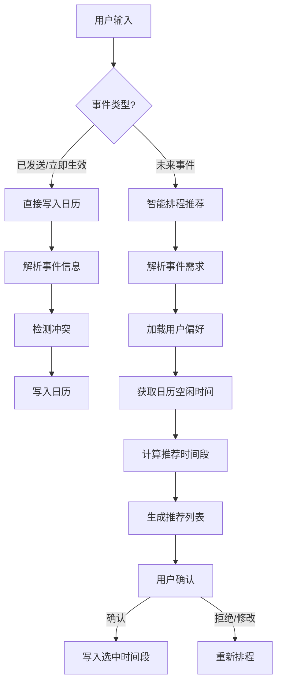

# Outlook Calendar Scheduler

## Overview

本技能实现与 Outlook Calendar 的集成，核心能力：
- **认证授权**：基于 OAuth2 授权码模式获取 Graph API 访问令牌
- **日历操作**：查看、创建、更新、删除用户日历事件
- **已完成事件标记**：识别已完成/已发生事件，写入时在标题末尾追加 `[已完成]`
- **智能排程**：根据用户输入的未来事件，对比日历现有安排，推荐最佳时间段
- **多时区支持**：自动处理时区转换和夏令时
- **偏好学习**：记录用户工作时间、会议偏好、缓冲时间等规则

## Workflow Decision Tree



## Quick Start

### Portable Execution

Use `python run_outlook_calendar.py ...` from the skill root. The launcher locates `scripts/main.py` relative to its own file and runs with `cwd` set to the skill root, so it does not depend on a hardcoded user path. It checks `UV_BIN`, then non-interactive `PATH`, then common `uv` install locations. Set `OUTLOOK_CALENDAR_NO_UV=1` to force the cached-venv fallback. Set `OUTLOOK_CALENDAR_CACHE` to override the fallback venv cache directory. The self-test command `python run_outlook_calendar.py --launcher-self-test` performs no authentication or Microsoft Graph API calls.

### 1. 配置认证

在 Azure Portal 注册应用,获取以下信息并设置为环境变量(写入 `.env` 文件):

```bash
AZURE_CLIENT_ID="your-client-id"
AZURE_TENANT_ID="your-tenant-id"
AZURE_CLIENT_SECRET="your-client-secret"
REDIRECT_URI="http://localhost:8000/auth/microsoft/callback"
```

权限范围: `Calendars.ReadWrite User.Read`

### 2. CLI 命令使用

**认证(首次使用必需):**
```bash
python run_outlook_calendar.py auth
```

**列出所有日历:**
```bash
python run_outlook_calendar.py list-calendars
```

**查询事件:**
```bash
python run_outlook_calendar.py list-events --start 2025-04-21 --end 2025-04-28
```

**直接创建事件:**
```bash
# 方式1: 直接指定时间
python run_outlook_calendar.py create-event "团队会议" --start 2025-04-22T14:00 --end 2025-04-22T15:00

# 方式2: 自然语言描述
python run_outlook_calendar.py create-event --text "明天下午2点开会"
```

**智能排程未来事件:**
```bash
python run_outlook_calendar.py suggest "项目评审会" --duration 120 --days 7 --num 3
```

**删除事件:**
```bash
python run_outlook_calendar.py delete-event <event-id>
```

**查看偏好状态:**
```bash
python run_outlook_calendar.py status
```

## Core Capabilities

### 1. Authentication (scripts/auth.py)

使用 MSAL 库完成 OAuth2 授权码流程:

```python
from msal import ConfidentialClientApplication

app = ConfidentialClientApplication(
    client_id=AZURE_CLIENT_ID,
    client_credential=AZURE_CLIENT_SECRET,
    authority=f"https://login.microsoftonline.com/{AZURE_TENANT_ID}"
)

# 获取授权 URL 供用户登录
auth_url = app.get_authorization_request_url(
    scopes=["https://graph.microsoft.com/Calendars.ReadWrite",
            "https://graph.microsoft.com/User.Read"],
    redirect_uri=REDIRECT_URI
)

# 用授权码换取令牌
result = app.acquire_token_by_authorization_code(
    code=auth_code,
    scopes=["..."],
    redirect_uri=REDIRECT_URI
)
```

### 2. Calendar API (scripts/calendar_api.py)

封装 Graph API 调用:

- `list_calendars()` → 获取用户所有日历
- `list_events(calendar_id, start_time, end_time)` → 查询时间范围内的事件
- `create_event(subject, start_time, end_time, ...)` → 创建新事件
- `update_event(event_id, updates, calendar_id)` → 更新事件
- `delete_event(event_id, calendar_id)` → 删除事件
- `get_free_busy(schedules, start_time, end_time)` → 获取忙闲状态
- `find_meeting_times(attendees, duration_minutes, ...)` → 寻找共同会议时间

### 3. Smart Scheduling (scripts/scheduler.py)

排程算法核心:

```python
scheduler.suggest_times(
    duration_minutes: int,
    constraints: Optional[Dict],
    existing_events: List[Dict],
    lookahead_days: int = 7,
    num_suggestions: int = 3
) -> List[Dict]:
    """
    推荐最佳时间段
    
    返回: 按适宜度分数排序的推荐时间段列表
    [{
        "start": datetime,
        "end": datetime,
        "score": float,  # 0-1 适宜度分数
        "reason": str    # 推荐理由
    }]
    """
```

考虑因素:
- 用户工作时间限制 (默认 09:00-18:00)
- 会议前后缓冲时间 (默认 15 分钟)
- 现有事件的间隔要求
- 避开午休时间 (12:00-14:00)
- 历史选择偏好学习

### 4. Natural Language Parsing (scripts/nlp_parser.py)

从自然语言提取事件结构化信息:

```python
parse_event(text: str) -> dict:
    """
    返回格式:
    {
        "title": str,
        "start": datetime,
        "end": datetime,
        "duration_minutes": int,
        "location": str | None,
        "attendees": list[str] | None,
        "constraints": dict | None,  # 如"本周内"、"工作时间"
        "is_completed": bool         # 是否已完成/已发生事件
    }
    """
```

支持表达:
- "明天下午2点到3点开会"
- "下周一上午10点,1小时,项目讨论"
- "本周找个2小时的时间做评审(优先上午)"
- "今天下午3点开会已经完成" → `is_completed=True`，写入标题为 `开会[已完成]`

**已完成事件标题规则**（`create-event` 写入时自动生效）:
1. 自然语言含完成标记：`已完成` / `完成了` / `做完了` / `done` / `finished` 等
2. 事件结束时间（无 end 则看 start）早于当前时间
3. 命中后标题末尾追加 `[已完成]`，已有该后缀则不重复

### 5. Preference Learning (scripts/preference_learner.py)

学习并存储用户偏好:

- 记录用户经常选择的时间段
- 识别工作时间模式
- 学习会议时长偏好
- 保存缓冲时间习惯

存储位置: `.outlook_calendar_preferences.json`

### 6. Timezone Handling (scripts/timezone_utils.py)

多时区支持工具类:

```python
tz_handler = TimezoneHandler(user_timezone="Asia/Shanghai")
tz_handler.to_utc(local_dt)           # 本地时间转 UTC
tz_handler.from_utc(utc_dt)           # UTC 转本地时间
tz_handler.get_local_now()            # 获取当前本地时间
tz_handler.get_timezone_info()        # 获取时区信息
```

## Configuration

环境变量清单:

| 变量名 | 说明 | 必需 |
|--------|------|------|
| `AZURE_CLIENT_ID` | Azure 应用 Client ID | 是 |
| `AZURE_TENANT_ID` | Azure 目录 Tenant ID | 是 |
| `AZURE_CLIENT_SECRET` | 应用客户端密钥 | 是 |
| `REDIRECT_URI` | OAuth2 回调地址 | 是 |
| `GRAPH_API_VERSION` | Graph API 版本 (默认 v1.0) | 否 |
| `CALENDAR_SCHEDULER_DEBUG` | 启用调试日志 | 否 |

## Troubleshooting

### 认证失败
检查:
- Client ID 和 Tenant ID 是否匹配
- 应用是否配置了正确的重定向 URI
- 权限是否已授予并同意

### 时区问题
所有 API 调用使用 UTC,本地显示时根据用户时区转换。确保 `timezone_utils.py` 正确加载时区数据。

### 排程不准确
检查偏好学习数据文件是否存在且格式正确。可手动编辑 `.outlook_calendar_preferences.json` 重置。

## Advanced Usage

### 批量操作
使用 `scripts/calendar_api.py` 的批量方法处理多个事件。

### 自定义排程规则
修改 `scripts/scheduler.py` 中的权重计算函数,调整推荐算法。

### 集成外部日历
扩展 `list_events()` 以支持 Google Calendar 等其他来源,实现跨日历排程。

---

**资源说明**:
- `scripts/` - 核心功能脚本(可直接执行或导入)
- `references/` - Microsoft Graph API 详细文档和 OAuth2 配置指南
- `assets/` - 本 skill 暂未使用,可删除或存放模板文件
