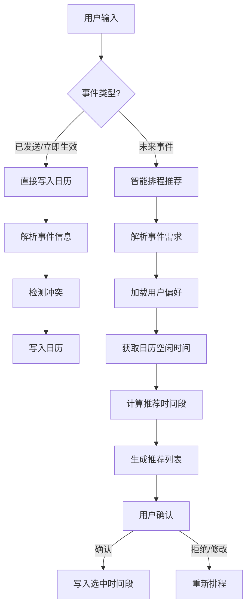

# Calendar Scheduler

## Overview

本技能实现与日历服务的集成，核心能力：
- **双后端**：`graph`（Microsoft Graph）与 `caldav`（QQ 邮箱等），事件契约统一，排程逻辑与后端无关
- **认证授权**：Graph 走 OAuth2 授权码模式；CalDAV 走 HTTP Basic（邮箱地址 + 16 位授权码）
- **日历操作**：查看、创建、更新、删除用户日历事件
- **已完成事件标记**：识别已完成/已发生事件，写入时在标题末尾追加 `[已完成]`
- **智能排程**：根据用户输入的未来事件，对比日历现有安排，推荐最佳时间段
- **多时区支持**：自动处理时区转换和夏令时
- **偏好学习**：记录用户工作时间、会议偏好、缓冲时间等规则

## Workflow Decision Tree



## Quick Start

### Portable Execution

Use `python run_calendar.py ...` from the skill root. The launcher locates `scripts/main.py` relative to its own file and runs with `cwd` set to the skill root, so it does not depend on a hardcoded user path. It checks `UV_BIN`, then non-interactive `PATH`, then common `uv` install locations. Set `CALENDAR_SCHEDULER_NO_UV=1` to force the cached-venv fallback. Set `CALENDAR_SCHEDULER_CACHE` to override the fallback venv cache directory. The self-test command `python run_calendar.py --launcher-self-test` performs no authentication or Microsoft Graph API calls.

### 1. 配置认证

先用 `CALENDAR_BACKEND` 选后端。留空时自动推断：配置了 `CALDAV_USERNAME` 且未配置 `AZURE_CLIENT_ID` → `caldav`，否则 `graph`。

| 后端 | 取值 | 认证方式 |
|------|------|----------|
| Microsoft Graph | `graph` | OAuth2 + MSAL 令牌缓存 |
| CalDAV | `caldav` | HTTP Basic（邮箱地址 + 授权码） |

**方式 A：Graph（Outlook / 个人 Microsoft 账户）**

在 Azure Portal 注册应用,获取以下信息并设置为环境变量(写入 `.env` 文件):

```bash
CALENDAR_BACKEND=graph
AZURE_CLIENT_ID="your-client-id"
AZURE_TENANT_ID="your-tenant-id"
AZURE_CLIENT_SECRET="your-client-secret"
REDIRECT_URI="http://localhost:8000/auth/microsoft/callback"
```

权限范围: `Calendars.ReadWrite User.Read`

**方式 B：CalDAV（QQ 邮箱）**

QQ 邮箱需先在网页端开启 CalDAV 服务并生成 16 位授权码：
设置 → 账户 → 「POP3/IMAP/SMTP/Exchange/CardDAV/CalDAV 服务」→ 生成授权码。

授权码**不是 QQ 登录密码**；修改 QQ 密码会让旧授权码失效，需要重新生成。

```bash
CALENDAR_BACKEND=caldav
CALDAV_BASE_URL=https://dav.qq.com
CALDAV_USERNAME=123456789@qq.com        # 必须是完整邮箱地址
CALDAV_PASSWORD=16位授权码
CALDAV_CALENDAR=                         # 可选：日历显示名或 href，留空自动选择
CALDAV_EXCLUDE_CALENDARS=Tasks,好友生日   # 可选：默认排除的日历
```

CalDAV 不跑 OAuth 流程；`auth` 命令会改为一次只读连接探针，并列出可用日历。

### 2. CLI 命令使用

**认证(首次使用必需):**
```bash
python run_calendar.py auth
```

**列出所有日历:**
```bash
python run_calendar.py list-calendars
```

**查询事件:**
```bash
python run_calendar.py list-events --start 2025-04-21 --end 2025-04-28
```

**直接创建事件:**
```bash
# 方式1: 直接指定时间
python run_calendar.py create-event "团队会议" --start 2025-04-22T14:00 --end 2025-04-22T15:00

# 方式2: 自然语言描述
python run_calendar.py create-event --text "明天下午2点开会"
```

**更新事件:**
```bash
# 修改标题与时间
python run_calendar.py update-event <event-id> --title "团队会议(改期)" \
  --start 2025-04-23T14:00 --end 2025-04-23T15:00

# 只修改地点/描述（传空字符串表示清除）
python run_calendar.py update-event <event-id> --location "3F 会议室"
```

**智能排程未来事件:**
```bash
python run_calendar.py suggest "项目评审会" --duration 120 --days 7 --num 3
```

**删除事件:**
```bash
python run_calendar.py delete-event <event-id>
```

**查看偏好状态:**
```bash
python run_calendar.py status
```

## Core Capabilities

### 1. Authentication (scripts/auth.py)

使用 MSAL 库完成 OAuth2 授权码流程:

```python
from msal import ConfidentialClientApplication

app = ConfidentialClientApplication(
    client_id=AZURE_CLIENT_ID,
    client_credential=AZURE_CLIENT_SECRET,
    authority=f"https://login.microsoftonline.com/{AZURE_TENANT_ID}"
)

# 获取授权 URL 供用户登录
auth_url = app.get_authorization_request_url(
    scopes=["https://graph.microsoft.com/Calendars.ReadWrite",
            "https://graph.microsoft.com/User.Read"],
    redirect_uri=REDIRECT_URI
)

# 用授权码换取令牌
result = app.acquire_token_by_authorization_code(
    code=auth_code,
    scopes=["..."],
    redirect_uri=REDIRECT_URI
)
```

### 2. Backend Layer (scripts/backend.py)

`get_calendar_client()` 返回当前后端，两个后端输出同一份事件契约。

| 后端 | 实现文件 | 说明 |
|------|----------|------|
| `graph` | `scripts/graph_backend.py` | Graph REST，跟随 `@odata.nextLink` 分页 |
| `caldav` | `scripts/caldav_backend.py`、`scripts/caldav_dav.py` | 裸 DAV 请求（PROPFIND/REPORT/PUT/DELETE），递归在本地展开 |

事件契约（12 键）：`id`、`subject`、`start`、`end`、`is_all_day`、`show_as`、`location`、`categories`、`recurring`、`etag`、`uid`、`source`。
其中 `start`/`end` 是带偏移的 ISO8601 字符串（如 `2026-10-27T10:00:00+08:00`），`show_as` 为 `busy`/`free`/`cancelled`。

公共方法（`scripts/backend.py` 的 `CalendarBackend` Protocol）:

- `list_calendars()` → 获取所有日历
- `get_default_calendar()` → 获取默认日历
- `list_events(calendar_id, start_time, end_time)` → 查询时间范围内的事件
- `create_event(subject, start_time, end_time, ...)` → 创建新事件
- `update_event(event_id, updates, calendar_id)` → 更新事件
- `delete_event(event_id, calendar_id)` → 删除事件
- `get_event(event_id, calendar_id)` → 获取单个事件

Graph 专有（不在 Protocol 内）：`get_free_busy()`、`find_meeting_times()`。

### 3. Smart Scheduling (scripts/scheduler.py)

排程算法核心:

```python
scheduler.suggest_times(
    duration_minutes: int,
    constraints: Optional[Dict],
    existing_events: List[Dict],
    lookahead_days: int = 7,
    num_suggestions: int = 3
) -> List[Dict]:
    """
    推荐最佳时间段
    
    返回: 按适宜度分数排序的推荐时间段列表
    [{
        "start": datetime,
        "end": datetime,
        "score": float,  # 0-1 适宜度分数
        "reason": str    # 推荐理由
    }]
    """
```

考虑因素:
- 用户工作时间限制 (默认 09:00-18:00)
- 会议前后缓冲时间 (默认 15 分钟)
- 现有事件的间隔要求
- 避开午休时间 (12:00-14:00)
- 历史选择偏好学习

### 4. Natural Language Parsing (scripts/nlp_parser.py)

从自然语言提取事件结构化信息:

```python
parse_event(text: str) -> dict:
    """
    返回格式:
    {
        "title": str,
        "start": datetime,
        "end": datetime,
        "duration_minutes": int,
        "location": str | None,
        "attendees": list[str] | None,
        "constraints": dict | None,  # 如"本周内"、"工作时间"
        "is_completed": bool         # 是否已完成/已发生事件
    }
    """
```

支持表达:
- "明天下午2点到3点开会"
- "下周一上午10点,1小时,项目讨论"
- "本周找个2小时的时间做评审(优先上午)"
- "今天下午3点开会已经完成" → `is_completed=True`，写入标题为 `开会[已完成]`

**已完成事件标题规则**（`create-event` 写入时自动生效）:
1. 自然语言含完成标记：`已完成` / `完成了` / `做完了` / `done` / `finished` 等
2. 事件结束时间（无 end 则看 start）早于当前时间
3. 命中后标题末尾追加 `[已完成]`，已有该后缀则不重复

### 5. Preference Learning (scripts/preference_learner.py)

学习并存储用户偏好:

- 记录用户经常选择的时间段
- 识别工作时间模式
- 学习会议时长偏好
- 保存缓冲时间习惯

存储位置: `.calendar_preferences.json`

### 6. Timezone Handling (scripts/timezone_utils.py)

多时区支持工具类:

```python
tz_handler = TimezoneHandler(user_timezone="Asia/Shanghai")
tz_handler.to_utc(local_dt)           # 本地时间转 UTC
tz_handler.from_utc(utc_dt)           # UTC 转本地时间
tz_handler.get_local_now()            # 获取当前本地时间
tz_handler.get_timezone_info()        # 获取时区信息
```

## Configuration

环境变量清单:

| 变量名 | 说明 | 必需 |
|--------|------|------|
| `CALENDAR_BACKEND` | 后端选择：`graph` / `caldav`，留空自动推断 | 否 |
| `AZURE_CLIENT_ID` | Azure 应用 Client ID | graph 必需 |
| `AZURE_TENANT_ID` | Azure 目录 Tenant ID | graph 必需 |
| `AZURE_CLIENT_SECRET` | 应用客户端密钥 | graph 必需 |
| `REDIRECT_URI` | OAuth2 回调地址 | graph 必需 |
| `GRAPH_API_VERSION` | Graph API 版本 (默认 v1.0) | 否 |
| `CALDAV_BASE_URL` | CalDAV 服务器地址（QQ 邮箱为 `https://dav.qq.com`） | caldav 必需 |
| `CALDAV_USERNAME` | CalDAV 账号，必须是完整邮箱地址 | caldav 必需 |
| `CALDAV_PASSWORD` | CalDAV 授权码（QQ 邮箱为 16 位授权码） | caldav 必需 |
| `CALDAV_CALENDAR` | 目标日历的显示名或 href，留空自动选择 | 否 |
| `CALDAV_EXCLUDE_CALENDARS` | 排除的日历名，逗号分隔（默认 `Tasks,好友生日`） | 否 |
| `CALENDAR_SCHEDULER_DEBUG` | 启用调试日志 | 否 |

## Troubleshooting

### 认证失败
检查:
- Client ID 和 Tenant ID 是否匹配
- 应用是否配置了正确的重定向 URI
- 权限是否已授予并同意

### QQ 邮箱 / CalDAV 认证失败
- **401**：授权码错误、已失效，或网页端未开启 CalDAV 服务
- **404**：`CALDAV_BASE_URL` 不对；QQ 邮箱必须是 `https://dav.qq.com`（`caldav.qq.com` 等地址不可用）
- 用户名必须是完整邮箱地址，不是 QQ 号
- 修改过 QQ 密码会让旧授权码失效，需重新生成

### 时区问题
所有 API 调用使用 UTC,本地显示时根据用户时区转换。确保 `timezone_utils.py` 正确加载时区数据。

### 排程不准确
检查偏好学习数据文件是否存在且格式正确。可手动编辑 `.calendar_preferences.json` 重置。

## Advanced Usage

### 批量操作
使用 `scripts/calendar_api.py` 的批量方法处理多个事件。

### 自定义排程规则
修改 `scripts/scheduler.py` 中的权重计算函数,调整推荐算法。

### CalDAV 已知限制（QQ 邮箱实测）

- **单资源 GET 永远 404**：读路径只有 `REPORT calendar-query`，没有 `get_event` 式的直读
- **`If-Match` / `If-None-Match` 被忽略**：没有乐观并发控制，写入是 last-write-wins
- **`C:expand` 被忽略**：递归事件必须用 `recurring-ical-events` 在本地展开
- **`calendar-multiget` 返回空**：不要依赖它补齐缺失的 `calendar-data`
- **`prop-filter` 按 UID 过滤被忽略**：会返回整个集合，`get_event` 靠 href 复核
- **集合 URL 必须带尾斜杠**：否则返回的资源 href 会畸形拼接
- **`Tasks` / `好友生日` / 聚合集合都自报支持 VEVENT**：只能按名字和 principal 排除
- **写入统一用 UTC `Z`**：不写 `TZID`、不写 `VTIMEZONE`，从根上避开夏令时歧义
- **更新事件已支持**：实现方式是「REPORT 取回原 ICS → 改属性 → PUT 覆盖同一 href」，保留 `RRULE`/`EXDATE`/`VALARM`/`ATTENDEE`/`ORGANIZER`/`CATEGORIES`/`UID` 等未涉及属性
  - **不支持修改递归系列中的单个实例**（带 `#RECURRENCE-ID` 的 id 会直接报错）
  - **无并发保护**：`If-Match`/`If-None-Match` 被忽略，写入是 last-write-wins
  - **QQ 会丢弃 `LAST-MODIFIED` 并重写 `DTSTAMP`**：不能用它们判断版本，以本地返回值为准
  - 修改递归主事件的时间会让整个系列平移

---

**资源说明**:
- `scripts/` - 核心功能脚本(可直接执行或导入)
- `references/` - Microsoft Graph API 详细文档和 OAuth2 配置指南
- `assets/` - 本 skill 暂未使用,可删除或存放模板文件
